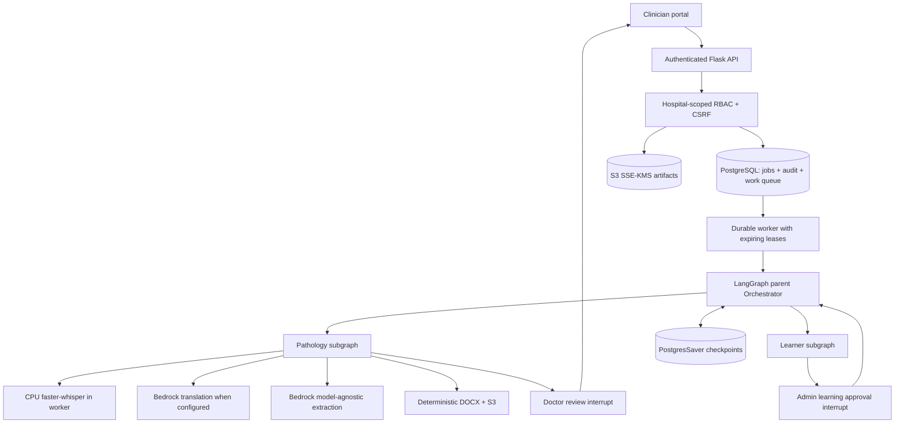

# Vaidya AI production-engineering architecture

In the new code, `production_app.py` serves the authenticated Flask interface, `production.worker` executes work outside the request, and `production.graph.ProductionGraph` compiles one parent graph with Pathology/Learner subgraphs and PostgresSaver. The original `app.py` remains a synthetic local-demo program. Do not deploy both under the same URL without explicit routing/isolation.

Production reports use versioned S3 references and stored SHA-256 checksums. Stage memory carries references instead of raw patient content; model prompts are transient. Clinical data may be stored in protected checkpoint data structures by framework internals, so checkpoint retention and DB encryption remain mandatory.
