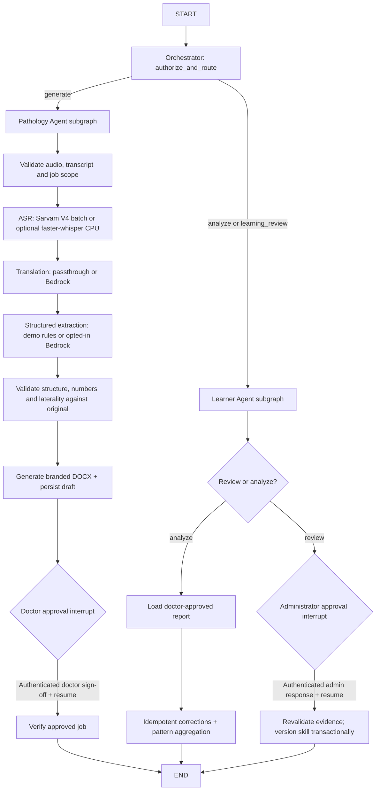

# Vaidya AI — Executable Multi-Agent Workflow Architecture

**Status:** Implemented as Python/LangGraph modules for **synthetic local demonstration**, not a production or clinically validated deployment.

## Actual graph structure

The **central Orchestrator** uses allowlisted workflow types and server-authorized identities (no AI reasoning necessary). The **Pathology Agent** is a compiled StateGraph subgraph, with LLM extraction as a replaceable provider adapter. The **Learner Agent** is a compiled StateGraph subgraph that uses deterministic correction analysis and transactional human-governed version promotion. The GraphRuntime's parent `StateGraph` compiles with `SqliteSaver` against `instance/langgraph_checkpoints.sqlite3` and unique thread IDs.

## Checkpoint / event design

- `vaidya:report:{job_id}`: generation and paused clinician review; doctor approves in authenticated Flask before `Command(resume=...)`.
- `vaidya:learning:{job_id}`: report diff and aggregated evidence after doctor approval.
- `vaidya:approval:{learning_id}`: paused administrator review; only authorized admin may resume using `Command(resume=...)`.
- Persisted LangGraph checkpoint history holds graph state and node position; `workflow_events` is an idempotent SQLite trace for UI.
- SQLite is strictly for local single-process use. The graph is invoked synchronously for short synthetic text inputs, **not** as a durable cloud job queue. Cloud/production-grade audio processing requires a queue, workers and PostgreSQL checkpointing.
- A report approved before resumption remains approved if learner analysis fails, but the status/UI alerts the operator to retry learning; do not equate a business DB status with a graph checkpoint status.

## Safety boundaries and honest omissions

- The application can transcribe actual CPU audio through Sarvam V4 batch or optional faster-whisper and translate with opt-in AWS Bedrock; both need runtime/model validation. It does not interpret pathology images or independently diagnose. Heuristic fidelity warnings do not medically validate outputs.
- The only supported data is synthetic. Global Bedrock profiles and any identifiable patient data require external approvals.
- Report-final authorization happens in Flask and in an extra LangGraph validation node. Learner skill promotion requires a role-checked admin response and at least five independently corrected jobs.
- The included synthetic pre-seeded report history was created by fixtures, not by LangGraph. Generate a new report after enabling graph to show real node traces.
- No external graph execution, Bedrock calls, hosted PostgreSQL, distributed queues or production security are claimed.

## Inspecting a live run

1. Start `python scripts/run_demo.py` after installing **requirements-dev.txt**.
2. Log in as doctor and generate a report from synthetic text.
3. Open the report review screen and inspect the LangGraph execution trace and checkpoint ID.
4. While still awaiting approval, restart Flask: the checkpoint remains persisted in `instance/langgraph_checkpoints.sqlite3`.
5. Approve the final report as doctor. The graph resumes and the Learner records corrections.
6. Sign in as administrator. An evidence-backed suggestion (5+ independent synthetic cases) can be approved/deferred/rejected; the decision resumes its own interrupted graph and only an approval versions the skill.
7. Use `python scripts/validate_complete.py` to run automated LangGraph restart/approval and Flask endpoint tests. Do not claim integration completeness unless every test passes in the intended runtime.

## Bedrock extraction integration (updated)

The `extract_structured_fields` Pathology node calls `get_provider().extract()`. With `LLM_PROVIDER=bedrock`, the provider uses `BedrockConverseProvider` and only approved synthetic test transcripts can be transmitted after explicit `ALLOW_REMOTE_SYNTHETIC_INPUT=true`. Extraction results are validated locally, and safe metadata from the Bedrock response (`model`, `latency_ms`, and `inputTokens`/`outputTokens` if present) is saved in `llm_calls`. The model cannot change job identity, approval state or learning policy. Clinical findings still need doctor sign-off.

`LLM_PROVIDER=demo` remains the offline no-cost mode. Model selection is configured by `LLM_EXTRACTION_MODEL` and `BEDROCK_MODELS`. The Learner's inference path remains deterministic pending separate evaluation and approval for optional LLM-assisted classification.

The inclusion of this adapter does NOT establish real AWS connectivity, medical accuracy or clinical production readiness. Run the opt-in synthetic smoke test and all strict Flask/LangGraph tests locally before a leadership live demonstration.
